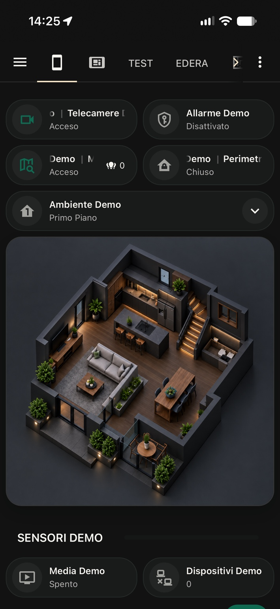
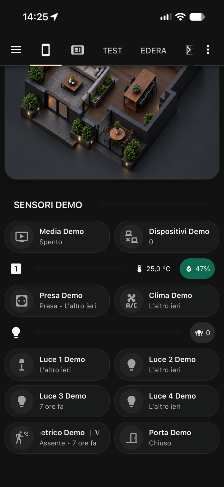
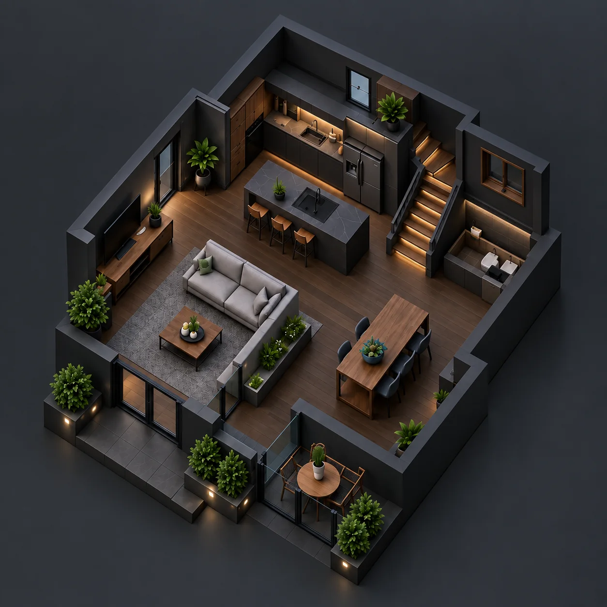
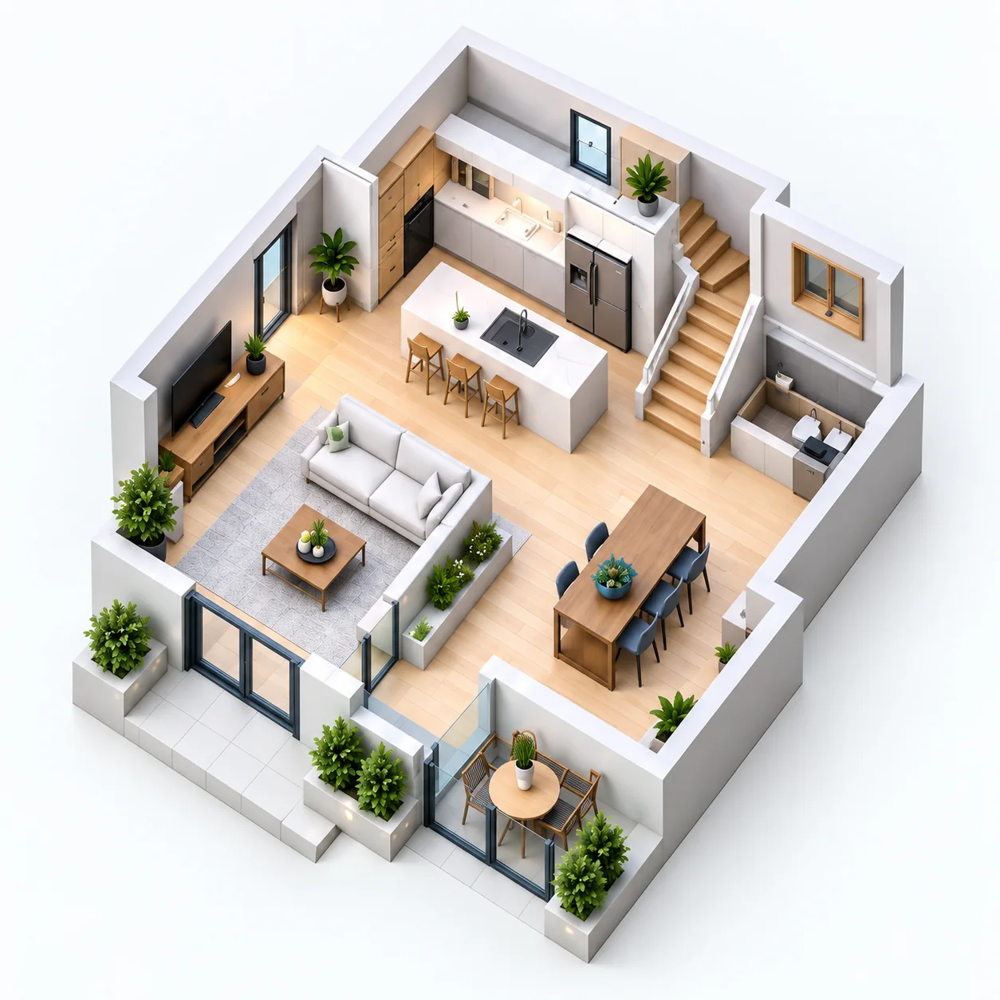

<a href="https://www.tiktok.com/@luigi.regolo" title="Segui i tutorial Home Assistant su TikTok"></a>

<div align="center">

# Home Mobile con tema Edera
### Home Assistant Dashboard · Designed by Edera

**Home Assistant · Edera Light + Graphite Dark · Piantina 3D**

[**PROVA HOME MOBILE — LIVE DEMO →**](https://luigi-regolo.github.io/home-mobile-home-assistant/) · [**Installa Edera**](https://github.com/luigi-regolo/Edera) · [**Come installare Home Mobile**](#installazione-demo-in-home-assistant)

</div>

> **Scopri Home Mobile:** prova l'interfaccia direttamente dal browser, con controlli dimostrativi e senza collegare dispositivi reali.

## Home Mobile in Edera Graphite Dark

Sicurezza, ambienti, piantina 3D, luci e sensori: tutto a portata di mano, con il tema **Edera Graphite Dark**. **Clicca sulle immagini per provare Home Mobile online.**

<a href="https://luigi-regolo.github.io/home-mobile-home-assistant/" title="Prova la demo interattiva di Home Mobile"></a>
<a href="https://luigi-regolo.github.io/home-mobile-home-assistant/" title="Prova la demo interattiva di Home Mobile"></a>

[**Prova la simulazione interattiva**](https://luigi-regolo.github.io/home-mobile-home-assistant/) · [**Installa Edera**](https://github.com/luigi-regolo/Edera)

## La dashboard segue i tuoi movimenti

**Automazione 07 · Funzione opzionale**

Con [**Dashboard automatica in base al movimento**](https://github.com/luigi-regolo/automazioni-home-assistant/blob/main/automations/dashboard/dashboard_automatica_movimento.yaml), un sensore che rileva movimento per almeno **1 secondo** imposta un'opzione del selettore ambienti. Home Mobile usa già questo selettore per mostrare le sezioni configurate per **Piano Terra** e **Primo Piano**.

[**Prova il cambio ambiente nella Live Demo →**](https://luigi-regolo.github.io/home-mobile-home-assistant/#automazione-movimento) · [**Scopri l'automazione 07 →**](https://github.com/luigi-regolo/automazioni-home-assistant/blob/main/automations/dashboard/dashboard_automatica_movimento.yaml)

Il blueprint non cambia pagina e non accende lo schermo: modifica un `input_select`. Per cambiare ambiente servono un sensore e un'automazione configurata per ciascuna opzione desiderata.

## Il progetto

**Home Mobile** porta il tema **Edera** in una dashboard per smartphone: sicurezza, piantina 3D, ambienti, luci, climatizzazione e sensori in un'interfaccia pensata per essere utilizzata con una sola mano. Il layout Home Assistant si basa su Bubble Card.

### Scopri Edera — il tema consigliato

**Edera** è il tema ufficialmente consigliato per Home Mobile: offre due modalità coordinate, **Light** e **Graphite Dark**, una palette di colori semantici e uno stile coerente per le interfacce Home Assistant. La dashboard Home Mobile usa Bubble Card; il tema Edera è fortemente consigliato per ottenere l'aspetto mostrato, **ma è installato separatamente** e non installa la dashboard.

[](https://my.home-assistant.io/redirect/hacs_repository/?owner=luigi-regolo&repository=Edera&category=theme)

**Repository e documentazione Edera:** https://github.com/luigi-regolo/Edera

> **Vuoi lo stesso risultato degli screenshot?** Installa Edera, attiva Graphite Dark e poi importa Home Mobile. La versione chiara segue Edera Light. Home Mobile non modifica né reinstalla il tema.

### Piantine dimostrative incluse

| Edera Graphite Dark | Edera Light |
| :---: | :---: |
|  |  |

Puoi sostituire entrambe le piantine con le immagini della tua casa. La dashboard le legge come normali file locali di Home Assistant: non vengono raccolti né inviati dati a servizi esterni.

## Cosa include

| Percorso | Contenuto |
| --- | --- |
| [`index.html`](index.html), [`assets/`](assets) | Live Demo interattiva da provare nel browser |
| [`home-assistant/dashboard.yaml`](home-assistant/dashboard.yaml) | Configurazione Lovelace da importare in Home Assistant |
| [`home-assistant/packages/home_mobile_demo.yaml`](home-assistant/packages/home_mobile_demo.yaml) | Entità demo isolate (`hm_`): helper, sensori template e 4 luci dimmerabili simulate |
| [`home-assistant/www/home-mobile/`](home-assistant/www/home-mobile) | Immagini PNG della piantina per `/config/www/home-mobile/` |
| [`docs/PERSONALIZZAZIONE.md`](docs/PERSONALIZZAZIONE.md) | Sostituzione immagini, entità e layout |

## Requisiti Home Assistant

- Home Assistant aggiornato e funzionante, con accesso amministrativo per importare la dashboard.
- **Bubble Card**, installata tramite [HACS](https://www.hacs.xyz/) seguendo la [documentazione ufficiale Bubble Card](https://github.com/Clooos/Bubble-Card). È necessaria per le card `custom:bubble-card` usate da Home Mobile.
- **Edera Theme**, fortemente consigliato; è indipendente dalla dashboard. [Installazione Edera](https://github.com/luigi-regolo/Edera#provalo-subito).
- Copia delle due immagini PNG in `/config/www/home-mobile/`.
- Facoltativo: un package YAML con entità demo per provare tutti i controlli senza dispositivi veri.

La dashboard usa le card `custom:bubble-card` e alcune card standard di Home Assistant (`picture-elements`, `conditional`, `vertical-stack` e `horizontal-stack`). **Bubble Card è una dipendenza di Home Mobile, non di Edera.**

## Come usare Home Mobile nel proprio Home Assistant

**Ci sono due modalità:**

- **Prova demo:** installi il package `home_mobile_demo.yaml` e puoi utilizzare pulsanti e luci simulate senza collegarti a dispositivi reali.
- **Installazione personale:** importi il file della dashboard e sostituisci progressivamente le entità `hm_` con i tuoi `entity_id`. Adatta le card quando cambia il dominio dell’entità (per esempio demo `input_boolean` → `climate`). Le entità che non configuri non funzioneranno finché non saranno collegate.

## Installazione demo in Home Assistant

**Prima di procedere:** effettua un backup di Home Assistant. Il package demo aggiunge nuove entità, mentre l'importazione della dashboard modifica solo la nuova dashboard scelta. Non sovrascrivere le tue dashboard esistenti.

1. **Installa Bubble Card** da HACS, poi aggiorna il frontend come indicato dal progetto [Bubble Card](https://github.com/Clooos/Bubble-Card).
2. **Installa Edera** da HACS come tema e selezionalo dal tuo profilo Home Assistant. Segui la [guida Edera](https://github.com/luigi-regolo/Edera).
3. **Immagini:** copia `home-assistant/www/home-mobile/floorplan-light.png` e `floorplan-dark.png` nella cartella `/config/www/home-mobile/` della tua istanza. I percorsi usati nella dashboard saranno `/local/home-mobile/floorplan-light.png` e `/local/home-mobile/floorplan-dark.png`.
4. **Entità demo (facoltativo, ma necessario per provare la demo senza dispositivi reali):** copia `home-assistant/packages/home_mobile_demo.yaml` in `/config/packages/home_mobile_demo.yaml`. Se non hai ancora abilitato i package, integra nel tuo `configuration.yaml` esistente il blocco seguente **senza duplicare la chiave `homeassistant:`**:

   ```yaml
   homeassistant:
     packages: !include_dir_named packages
   ```

   Se usi già package con altre direttive, non sostituirle: integra il file nel tuo sistema di inclusioni attuale. Controlla la validità della configurazione, quindi riavvia Home Assistant. Verifica che compaiano, tra le altre, `input_boolean.hm_telecamere_demo`, `light.hm_luce_1_demo`, `sensor.hm_luci_accese` e `input_select.hm_ambiente_demo`. Se uno degli ID fosse già occupato, Home Assistant potrebbe aggiungere un suffisso: correggi prima l'eventuale conflitto.

5. **Dashboard:** crea una **nuova** dashboard in *Impostazioni → Dashboard*, aprila in modalità modifica e scegli l'editor di configurazione grezza. Incolla integralmente [`dashboard.yaml`](home-assistant/dashboard.yaml), salva e ricarica la pagina.


Per riportare i dati della tua casa, sostituisci progressivamente gli ID di demo nell'editor con i tuoi `entity_id`. Non è necessario mantenere installato il package una volta completata la personalizzazione e rimossi i suoi riferimenti.

## Personalizzazione piantina

Per usare la tua piantina, sostituisci i file `floorplan-light.png` e `floorplan-dark.png` nella cartella `/config/www/home-mobile/`, mantenendo gli stessi nomi. **Non serve modificare lo YAML**. Per immagini con nomi e percorsi diversi, aggiorna `image` e `dark_mode_image` nella card `picture-elements`.

Approfondimento: [Personalizzazione e sostituzione entità](docs/PERSONALIZZAZIONE.md).

## Prova Home Mobile online

[**PROVA HOME MOBILE — LIVE DEMO →**](https://luigi-regolo.github.io/home-mobile-home-assistant/)

Scopri l'interfaccia, esplora le sezioni e prova i controlli simulati, senza installare nulla. La demo web riproduce visivamente la dashboard e non controlla dispositivi reali.

Vuoi portarla nel tuo Home Assistant? Segui la [guida all'installazione](#installazione-demo-in-home-assistant) e scopri il [tema Edera](https://github.com/luigi-regolo/Edera).

## Crediti e licenze

- [**Home Assistant**](https://www.home-assistant.io/) è il software sul quale viene installata la dashboard.
- [**HACS**](https://www.hacs.xyz/) serve per installare e gestire le componenti della community.
- [**Bubble Card**](https://github.com/Clooos/Bubble-Card) è un progetto di terze parti con licenza **MIT**. Home Mobile non redistribuisce il suo codice.
- [**Edera Theme**](https://github.com/luigi-regolo/Edera) è un progetto separato con licenza **GPL-3.0**, consigliato per l’aspetto della dashboard. Il suo codice non viene duplicato in questo repository.
- Le piantine incluse sono immagini esclusivamente dimostrative, create con ChatGPT e fornite dall’autore del progetto; gli utenti possono sostituirle.

### Privacy e sicurezza

- Solo immagini dimostrative e entità `hm_` sono incluse nei file pubblici.
- **Le immagini pubblicate tramite `/config/www/` (`/local/`) non sono protette dall’autenticazione Home Assistant**: usa piantine dimostrative o immagini che puoi rendere pubbliche, mai planimetrie riservate.
- Nessun token, password, host, indirizzo IP, URL privato, ID dispositivo fisico o account è necessario.
- La preview non effettua richieste a Home Assistant né a server per pilotare entità.
- Per installare package YAML, prima esegui un backup e controlla la configurazione.

## Compatibilità e manutenzione

Edera e Bubble Card sono progetti separati; Home Mobile richiede Bubble Card e ne segue eventuali cambiamenti. Per la massima stabilità controlla le note di rilascio prima di aggiornare le card personalizzate e conserva un backup del file `dashboard.yaml`. Il package demo usa helper e integrazione Template ufficiali di Home Assistant.

## Licenza

**Home Mobile** è distribuito con licenza **GNU General Public License v3.0 (GPL-3.0)**. Il testo integrale è nel file [`LICENSE`](LICENSE). Le dipendenze di terzi mantengono le proprie licenze e non sono incluse nei file del progetto.

---

<div align="center">

**Home Mobile × [Edera Theme](https://github.com/luigi-regolo/Edera)**

*Designed for Home Assistant. Styled with Edera.*

</div>
